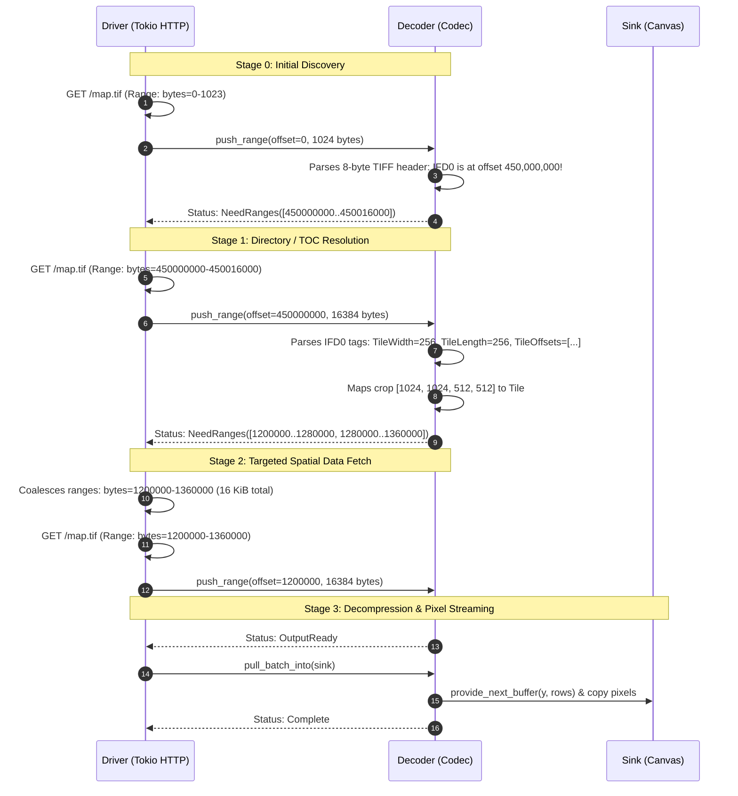

# Range-Aware Sans-I/O Decoding Contract

This document defines the architectural contract between **Range-Aware Decoders** (e.g., Cloud-Optimized GeoTIFF, JPEG XL, AVIF, Imij) and **Network/Transport Drivers** (e.g., Tokio HTTP with `Range: bytes=start-end`).

---

## 1. Why `Inventory` Cannot Work Without the Full File

`zencodec::inventory::Inventory` is an **exhaustive structural audit**:
- By design, `Inventory::validate()` requires that every single byte from `0..len` belongs to a known part or is explicitly accounted for as slack or trailing padding.
- Its purpose is post-facto security and integrity verification: ensuring that untrusted files do not contain invisible polyglots, steganography, or unparsed metadata payloads.
- To produce an `Inventory`, the caller **must already possess the entire file**.

When an HTTP client encounters a remote image:
1. The client does not possess the whole file. It may not even know the file's total length.
2. In formats like TIFF or BigTIFF, the primary Image File Directory (`IFD0`) can be placed at the very end of a 10 GB file.
3. In un-optimized MP4/AVIF containers, the `moov` or `meta` box can appear at the end of the file.
4. In JPEG XL, the Table of Contents (TOC) describes AC groups that span hundreds of megabytes.

Therefore, progressive cloud decoding **cannot** use the whole-file `Inventory` model. Instead, it requires an **interactive, multi-stage dialogue** between the Driver and the Decoder.

---

## 2. The Two Sides of the Contract

The separation of concerns between Driver and Decoder must remain absolute:

```
┌────────────────────────────────────────────────────────┐
│                      THE DRIVER                        │
│   (Tokio / Reqwest / Hyper / File System / Cloud S3)   │
│                                                        │
│  - Transport: HTTP/1.1 Range, HTTP/2 & HTTP/3 multiplex│
│  - Network performance: Latency, RTT, connection pools │
│  - Optimization: Range coalescing across small gaps    │
│  - Resource caps: Bounded memory buffers in RAM        │
│  - Cancellation & Progress: how_far::Pulse             │
└───────────────────────────┬────────────────────────────┘
                            │ ByteRangeRequests /
                            │ push_range(offset, chunk)
┌───────────────────────────▼────────────────────────────┐
│                      THE DECODER                       │
│             (TIFF, JXL, AVIF, Imij, WebP)              │
│                                                        │
│  - Format parsing: IFD tags, TOCs, boxes, markers      │
│  - Spatial mapping: (x, y, w, h) crop → tile offsets   │
│  - Decompression: IDCT, wavelets, entropy decoding     │
│  - Bounded rows: decoded scanlines in strip buffers    │
│  - Zero I/O: Never touches sockets, files, or URLs     │
└────────────────────────────────────────────────────────┘
```

### The Decoder Side (Domain Expert on Codecs)
* **What it knows:**
  - Container binary structures (TIFF IFD chains, JXL TOC / Frame Index, AVIF `iloc` / `mdat`).
  - Spatial tile geometry: which compressed tiles or AC groups intersect the requested crop rectangle `[x, y, w, h]` or page index.
  - Entropy decoding and pixel reconstruction.
* **What it must NEVER know:**
  - URLs, HTTP headers, TCP connections, TLS handshakes, or S3 credentials.
  - Round-trip times, network latency, or retry policies.
* **Its contract obligation:**
  - Expose the exact byte ranges it currently needs via `requested_ranges()`.
  - Accept chunks tagged with their absolute stream offset: `push_range(offset, chunk)`.
  - Signal status cleanly:
    - `PushStatus::NeedRanges`: needs non-contiguous byte ranges to proceed.
    - `PushStatus::NeedMoreInput`: needs sequential continuation at the current cursor.
    - `PushStatus::OutputReady`: scanlines ready to pull.
    - `PushStatus::BlockedOnOutput`: internal row buffer full; caller must drain.
    - `PushStatus::Complete`: decoding fully finished.

### The Driver Side (Domain Expert on Transport & Systems)
* **What it knows:**
  - Transport protocols: `Range: bytes=start-end`, HTTP/2 multiplexing, local NVMe seek, S3 `GetObject(Range=...)`.
  - Latency vs. bandwidth trade-offs (network RTT vs. throughput).
  - Tokio task scheduling, concurrency, and async cancellation.
* **What it must NEVER know:**
  - The internal bitstream format of JPEG XL, AVIF, or TIFF.
  - What an IFD, TOC, or MCU strip is.
* **Its contract obligation:**
  - Inspect `decoder.requested_ranges()`.
  - Coalesce adjacent or nearby ranges to minimize network round-trips.
  - Fetch requested byte ranges over the transport.
  - Feed bytes to `decoder.push_range(offset, chunk)`.
  - Drain scanlines via `decoder.pull_batch_into(sink)`.

---

## 3. The Multi-Stage Handshake Protocol



---

## 4. Network Latency & Range Coalescing

In real network environments, **latency dominates over raw bandwidth**.

### The Math:
Suppose Tile 1 is at bytes `10,000..20,000` (10 KiB) and Tile 2 is at bytes `26,000..36,000` (10 KiB).
The gap between them is 6 KiB.

- **Option A (Two Independent Requests):**
  - Bytes transferred: 20 KiB.
  - Requests: 2 HTTP round-trips.
  - Over a mobile connection (50 ms ping): **Total time = 100 ms**.
- **Option B (Coalesced Single Request `10000..36000`):**
  - Bytes transferred: 26 KiB (includes 6 KiB wasted gap bytes).
  - Requests: 1 HTTP round-trip.
  - At 50 Mbps connection speed: downloading 6 KiB takes 0.9 ms.
  - **Total time = 51 ms (nearly 2x faster!)**.

### The Coalescing Rule:
A driver coalesces two requested byte ranges if:
$$\text{Gap} = \text{Offset}_{B} - (\text{Offset}_{A} + \text{Length}_{A}) \le \text{MAX\_COALESCE\_GAP}$$

Default recommendation for HTTP: `MAX_COALESCE_GAP = 16 KiB .. 64 KiB`.
`zencodec::helpers::sansio::coalesce_byte_ranges` provides this calculation out of the box.

---

## 5. CDN and Server Caveats

1. **`multipart/byteranges` is unreliable:**
   HTTP/1.1 permits `Range: bytes=0-100, 200-300`, which returns a single `multipart/byteranges` response. In practice, many CDNs (Cloudflare, AWS CloudFront) and reverse proxies do not support multipart ranges properly, either returning `200 OK` (entire file download) or `400 Bad Request`.
   **Driver Recommendation:** Do not use multipart ranges. Use coalescing for small gaps, and multiplex independent requests over HTTP/2 or HTTP/3 streams.
2. **Fallback on `200 OK`:**
   If a server does not support `Accept-Ranges: bytes`, it will respond to a Range request with `200 OK` and stream the full file from byte 0. The driver must detect `status == 200` on the initial probe and fall back to sequential `push_chunk`.

---

## 6. The contract in `zencodec`

One resumable decoder contract, one source trait, one job-level binding
for pull-native cores. Drivers and the coroutine live in sibling crates.

```rust
// zencodec::decode
pub trait IncrementalDecode {
    type Error: core::error::Error + Send + Sync + 'static;

    /// Offer bytes at an absolute offset; returns how many were accepted.
    /// `eof` means `offset + bytes.len()` is the total length.
    fn feed(&mut self, offset: u64, bytes: &[u8], eof: bool) -> Result<usize, Self::Error>;

    /// Advance as far as fed bytes allow, writing rows into `sink`.
    fn step(&mut self, sink: &mut dyn DecodeRowSink, stop: Option<&dyn Stop>)
        -> Result<Step<'_>, Self::Error>;

    fn wrap_sink_error(err: SinkError) -> Self::Error;
    fn info(&self) -> Option<&ImageInfo>;
    fn output_descriptor(&self) -> Option<PixelDescriptor>;   // default None
    fn access_pattern(&self) -> AccessPattern;                 // default Sequential
}

#[non_exhaustive]
pub enum Step<'a> {
    Need(&'a [ByteRange]),   // length 0 = "any amount from offset" (sequential)
    NeedLen,                 // answer with feed(len, &[], true)
    Rows { meta: BatchMeta, rows: u32 },
    Metadata(MetadataUpdate),
    Done(OutputInfo),
}

// zencodec::source
pub trait ReadAt {
    type Error;
    fn len(&mut self) -> Result<u64, Self::Error>;
    fn read_exact_at(&mut self, offset: u64, out: &mut [u8]) -> Result<(), Self::Error>;
    fn read_many_at(&mut self, reqs: &mut [(u64, &mut [u8])]) -> Result<(), Self::Error>;
}
pub trait DynReadAt: Send { /* the object-safe form jobs receive */ }

// zencodec::decode::DecodeJob
fn push_decoder_from_source(self, source: &mut dyn DynReadAt,
    sink: &mut dyn DecodeRowSink, preferred: &[PixelDescriptor])
    -> Result<OutputInfo, BoxedError>;   // default: UnsupportedOperation::SeekableDecode
```

Rules the contract fixes:

- `feed` stores, `step` works. `feed` never decodes and never touches the
  sink; a decoder with a bounded input buffer accepts fewer bytes than
  offered and the driver re-offers the rest after a step. Bytes the
  decoder did not ask for are accepted and discarded.
- `step` returns the first event and does a bounded amount of work. It
  calls `sink.begin` before the first rows and `sink.finish` before
  `Done`. Backpressure is "do not step until the sink can take the next
  strip": an event loop simply does not step, a worker thread blocks in
  its sink.
- After `Err`, the decoder is finished; further steps error. After `Done`,
  steps return `Done` again.
- Provisional rows (progressive passes) are written only when the sink
  says `accepts_provisional()`, through `provide_pass_buffer`; a
  final-only sink sees each row once, in final form.
- The `stop` token is checked at least once per step. `how_far::Pulse:
  Stop`, so a pulse passes where a stop is expected; no codec names
  `how_far` types.
- Crop and region intent stay on the job; the sink's coordinate space is
  the output image.

### Which shape a codec implements

| codec core | implements | drivers get the other shape via |
|---|---|---|
| sequential or hand-written state machine (PNG, WebP, GIF, QOI) | `IncrementalDecode` | `zencodec-io::drive_from_read_at` serves it from any `ReadAt` |
| straight-line container walk written by us (TIFF, imij bridge, ISOBMFF) | `IncrementalDecode` through `zencodec-coroutine` | same |
| third-party pull-native library (reads `Read + Seek`) | `push_decoder_from_source` | `zencodec-io::thread::pull_decode_on_thread` for async drivers, or a spool |

Both shapes stay because each has a cell the other cannot serve without
cost: a pull-native library on a seekable file wants the `ReadAt` handed
to it directly, and a resumable core is the only thing that runs on an
async or threadless driver. What is gone is a second trait family: the
pull shape is one job method with the `push_decoder` signature.

## 7. Drivers (`zencodec-io`)

| input | resumable decoder | pull-native decoder |
|---|---|---|
| slice | `drive_from_slice` | `SliceReadAt` |
| `ReadAt` (file, object store, FFI `read_at` callback) | `drive_from_read_at` | direct |
| `std::io::Read` stream | `pump_read_to_sink` | `BufferedReadAt` under a `BufferPolicy` |
| async runtime | `thread::decode_on_thread` | `thread::pull_decode_on_thread` |

- `drive_from_read_at` coalesces each `Need` round (gap `<= max_gap`)
  and fetches it with one `read_many_at`, so a concurrent source overlaps
  round trips. It asks for the source length only when a sequential
  request or `NeedLen` needs it, because a buffered stream answers by
  consuming to EOF.
- `pump_read_to_sink` feeds a stream at its cursor and lets the decoder
  emit rows as soon as it has enough; a sized request behind the cursor
  is `PumpError::NeedsRandomAccess`, with `BufferedReadAt` as the fix.
- `BufferedReadAt` manufactures seeks over a stream: `Window` (bounded
  retention, far-back reads fail with `BeyondWindow`) or `Spool` (retain
  up to a cap, `BeyondLimit` past it). `BufferPolicy::for_pattern` picks
  the cheapest policy that cannot fail for the decoder's declared
  `AccessPattern`. Buffering never silently grows and never returns wrong
  bytes.
- Every driver goes through `Feeder`, which re-offers bytes a bounded
  decoder did not accept and reports a decoder that refuses what it keeps
  asking for as `Stalled` instead of spinning.

### Cancellation and progress: one handle

Every driver takes `Option<&dyn how_far::Pulse>`. `Pulse: Stop + Report`,
so one value cancels and reports. A caller with only a `Stop` passes
`how_far::StopOnly::borrowed(&stop)`; a `StopToken` becomes a
`SharedPulse` with `StopOnly::new(token).share()`.

- The driver passes the pulse to every `step` as its stop, so the codec
  checks it at least once per strip.
- The driver calls `set_total(Total::Exact(height))` once the header is
  known (on `Step::Metadata(HeaderReady)`, or the first step after
  `info()` is available) and `advance(rows)` on every `Step::Rows`. A
  pulse that cannot take a total records its own issue; drivers ignore the
  result.
- Codec-side reporting inside a single step goes through the job-level
  pulse (`DecodeJob::with_pulse`), not through `step`. The step contract
  deliberately exposes only `Stop` to codecs.
- The thread bridge takes `Option<SharedPulse>`. Besides the per-step
  check, every blocking wait on the decode thread re-checks it: the wait
  for a fetch reply, and `ChannelRowSink::with_pulse`'s wait on a full
  strip channel. The wait spins briefly, then sleeps from 50 µs doubling to
  2 ms, so cancellation latency while blocked is at most a few
  milliseconds and an idle decode wakes at most 500 times a second.
  Without a pulse the waits are the channels' own blocking calls (no
  wakeups) and only dropping the future ends them.
- The async side races each fetch against the thread going away, so a
  fetch that never completes cannot keep a cancelled decode alive.
- `pull_decode_on_thread` cancels at the next read: every read through its
  `DynReadAt` checks the pulse, and the reply wait re-checks it. Row
  progress for a pull-native core is whatever its sink observes; the
  bridge cannot see rows written by code it does not drive.

### The async bridge, without async in codecs

`thread::decode_on_thread(decoder, sink, stop, opts, fetch)` runs the
decoder on a dedicated OS thread (or one the caller's pool supplies via
`ThreadOptions::with_spawner`). The thread blocks on two bounded
`tokio::sync` channels; the async side runs one loop that awaits each
`SourceRequest`, fetches it with the caller's `fetch` future, and sends
the bytes back. `fetch` is the only async code: it owns the HTTP client,
the body stream or the object store, and may fan a multi-range request
out across tasks (`read_many_at` from a pull-native core, or one
`Step::Need` with several ranges, becomes concurrent requests).

- No `spawn_blocking` per chunk, no decode on runtime workers, no
  `block_on`: the decode thread and the runtime never share a stack.
- Rows stream back through `ChannelRowSink`, which ships each finished
  strip as an owned `PixelBuffer` over a bounded channel with
  `blocking_send`: a slow consumer throttles the decoder instead of the
  decoder filling memory. A sink the caller moves onto the thread can
  instead write straight into its own buffer.
- Dropping the async future closes the request channel; the thread exits
  at its next request and drops the sink. A `StopToken` cancels mid-strip.
- `fetch_from_async_read` serves a sequential decoder from any
  `AsyncRead` (an HTTP body); `fetch_from_bytes` serves tests and
  already-buffered input.
- `pull_decode_on_thread(run, sink, opts, fetch)` gives a pull-native core
  a `DynReadAt` whose reads block on the same channel, so a codec written
  against `push_decoder_from_source` streams from an async transport with
  no buffering beyond each read.

The production proxy topology follows directly: a Tokio task per request
owns the sockets and calls `decode_on_thread` with a pool spawner sized
to the machine's cores; the codec, the resizer and the encoder run
synchronously on that thread, strip by strip, with the bounded channels
as the only coupling to the runtime. Memory per request is the input
window plus the strips in flight, for codecs and encoders that stream
rows; whole-frame encoders (the AV1 backends) still materialise a frame
and must be budgeted as such.

## 8. Authoring (`zencodec-coroutine`)

A resumable decoder written by hand is a state enum per parser stage.
`zencodec-coroutine` repurposes `async`/`await` as a compile-time
coroutine generator: the author writes sequential code against a
`CoroutineContext` (`read_exact_at`, `read_many_at`, `read_exact`, `len`,
`write_rows`, `announce`), `rustc` synthesises the state machine, and
`CoroutineDecoder` polls it behind the ordinary `IncrementalDecode`
surface. No runtime, no executor, no threads; `no_std + alloc`,
`forbid(unsafe_code)`.

Cost: each suspending `.await` is one poll round trip through the driver.
Rows are copied once, from the codec's strip into the sink. Input is
copied once into the store and retained only until read, under a byte
cap; sequential reads release everything behind the cursor without
copying (segments release from the front by moving a head index, and
buffers of consumed segments are reused). The decoder is terminal after
an error, reports `UnexpectedEof` once the announced length shows a read
can never be served, and names only the missing gaps of a partially
satisfied read so a driver never fetches the same bytes twice.

## 9. Measured overhead

The framework's cost with a decoder whose own work is a memcpy per strip
(`zencodec-io/benches/fixture.rs`), so the numbers are the driver and
coroutine overhead, not codec work. Allocation counts from
`zencodec-io/examples/alloc_audit.rs` (a counting global allocator, all
threads); timings from `zencodec-io/benches/drivers.rs` (zenbench, with
its per-iteration allocation profiler on the bench thread). Records with
host and commit: `zencodec-io/benchmarks/`.

Rule for hand-written decoders, learned from the first run of this
bench: release consumed input by advancing a head index and compact the
buffer only when the dead prefix dominates. Releasing with `Vec::drain`
shifts the whole remaining buffer on every strip and cost 13x at
16-row strips and 70x at 1-row strips over direct writes before the fix.
The testkit reference codec and the bench fixture are the template.

Known inherent costs: the coroutine copies each fed chunk into its store
and each strip into the sink; `ChannelRowSink` allocates one owned
`PixelBuffer` per strip because the strip changes threads; the bridge
allocates per request for the request list and the fetched chunks.
