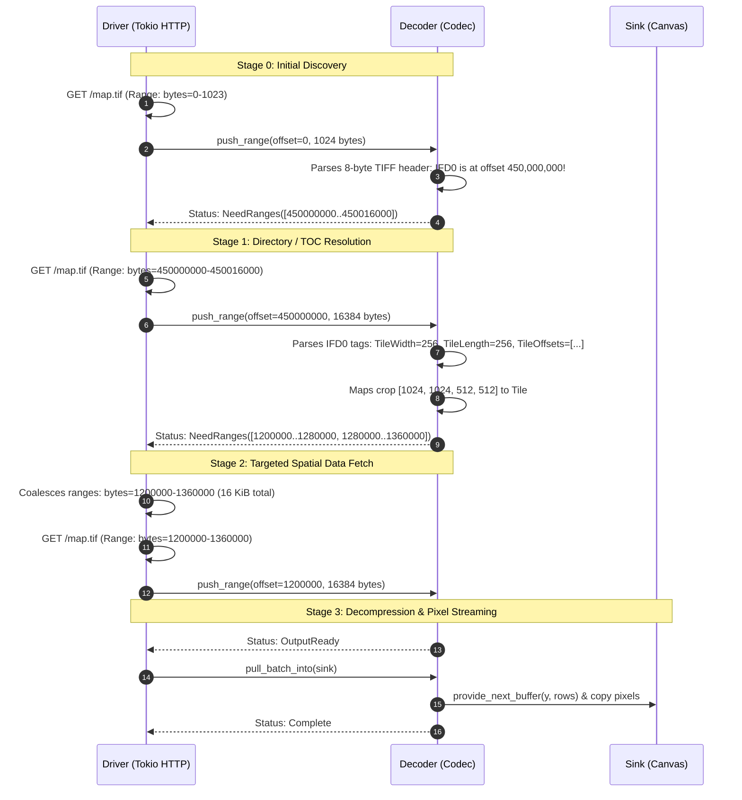

# Range-Aware Sans-I/O Decoding Contract

This document defines the architectural contract between **Range-Aware Decoders** (e.g., Cloud-Optimized GeoTIFF, JPEG XL, AVIF, Imij) and **Network/Transport Drivers** (e.g., Tokio HTTP with `Range: bytes=start-end`).

---

## 1. Why `Inventory` Cannot Work Without the Full File

`zencodec::inventory::Inventory` is an **exhaustive structural audit**:
- By design, `Inventory::validate()` requires that every single byte from `0..len` belongs to a known part or is explicitly accounted for as slack or trailing padding.
- Its purpose is post-facto security and integrity verification: ensuring that untrusted files do not contain invisible polyglots, steganography, or unparsed metadata payloads.
- To produce an `Inventory`, the caller **must already possess the entire file**.

When an HTTP client encounters a remote image:
1. The client does not possess the whole file. It may not even know the file's total length.
2. In formats like TIFF or BigTIFF, the primary Image File Directory (`IFD0`) can be placed at the very end of a 10 GB file.
3. In un-optimized MP4/AVIF containers, the `moov` or `meta` box can appear at the end of the file.
4. In JPEG XL, the Table of Contents (TOC) describes AC groups that span hundreds of megabytes.

Therefore, progressive cloud decoding **cannot** use the whole-file `Inventory` model. Instead, it requires an **interactive, multi-stage dialogue** between the Driver and the Decoder.

---

## 2. The Two Sides of the Contract

The separation of concerns between Driver and Decoder must remain absolute:

```
┌────────────────────────────────────────────────────────┐
│                      THE DRIVER                        │
│   (Tokio / Reqwest / Hyper / File System / Cloud S3)   │
│                                                        │
│  - Transport: HTTP/1.1 Range, HTTP/2 & HTTP/3 multiplex│
│  - Network performance: Latency, RTT, connection pools │
│  - Optimization: Range coalescing across small gaps    │
│  - Resource caps: Bounded memory buffers in RAM        │
│  - Cancellation & Progress: how_far::Pulse             │
└───────────────────────────┬────────────────────────────┘
                            │ ByteRangeRequests /
                            │ push_range(offset, chunk)
┌───────────────────────────▼────────────────────────────┐
│                      THE DECODER                       │
│             (TIFF, JXL, AVIF, Imij, WebP)              │
│                                                        │
│  - Format parsing: IFD tags, TOCs, boxes, markers      │
│  - Spatial mapping: (x, y, w, h) crop → tile offsets   │
│  - Decompression: IDCT, wavelets, entropy decoding     │
│  - Bounded rows: decoded scanlines in strip buffers    │
│  - Zero I/O: Never touches sockets, files, or URLs     │
└────────────────────────────────────────────────────────┘
```

### The Decoder Side (Domain Expert on Codecs)
* **What it knows:**
  - Container binary structures (TIFF IFD chains, JXL TOC / Frame Index, AVIF `iloc` / `mdat`).
  - Spatial tile geometry: which compressed tiles or AC groups intersect the requested crop rectangle `[x, y, w, h]` or page index.
  - Entropy decoding and pixel reconstruction.
* **What it must NEVER know:**
  - URLs, HTTP headers, TCP connections, TLS handshakes, or S3 credentials.
  - Round-trip times, network latency, or retry policies.
* **Its contract obligation:**
  - Expose the exact byte ranges it currently needs via `requested_ranges()`.
  - Accept chunks tagged with their absolute stream offset: `push_range(offset, chunk)`.
  - Signal status cleanly:
    - `PushStatus::NeedRanges`: needs non-contiguous byte ranges to proceed.
    - `PushStatus::NeedMoreInput`: needs sequential continuation at the current cursor.
    - `PushStatus::OutputReady`: scanlines ready to pull.
    - `PushStatus::BlockedOnOutput`: internal row buffer full; caller must drain.
    - `PushStatus::Complete`: decoding fully finished.

### The Driver Side (Domain Expert on Transport & Systems)
* **What it knows:**
  - Transport protocols: `Range: bytes=start-end`, HTTP/2 multiplexing, local NVMe seek, S3 `GetObject(Range=...)`.
  - Latency vs. bandwidth trade-offs (network RTT vs. throughput).
  - Tokio task scheduling, concurrency, and async cancellation.
* **What it must NEVER know:**
  - The internal bitstream format of JPEG XL, AVIF, or TIFF.
  - What an IFD, TOC, or MCU strip is.
* **Its contract obligation:**
  - Inspect `decoder.requested_ranges()`.
  - Coalesce adjacent or nearby ranges to minimize network round-trips.
  - Fetch requested byte ranges over the transport.
  - Feed bytes to `decoder.push_range(offset, chunk)`.
  - Drain scanlines via `decoder.pull_batch_into(sink)`.

---

## 3. The Multi-Stage Handshake Protocol



---

## 4. Network Latency & Range Coalescing

In real network environments, **latency dominates over raw bandwidth**.

### The Math:
Suppose Tile 1 is at bytes `10,000..20,000` (10 KiB) and Tile 2 is at bytes `26,000..36,000` (10 KiB).
The gap between them is 6 KiB.

- **Option A (Two Independent Requests):**
  - Bytes transferred: 20 KiB.
  - Requests: 2 HTTP round-trips.
  - Over a mobile connection (50 ms ping): **Total time = 100 ms**.
- **Option B (Coalesced Single Request `10000..36000`):**
  - Bytes transferred: 26 KiB (includes 6 KiB wasted gap bytes).
  - Requests: 1 HTTP round-trip.
  - At 50 Mbps connection speed: downloading 6 KiB takes 0.9 ms.
  - **Total time = 51 ms (nearly 2x faster!)**.

### The Coalescing Rule:
A driver coalesces two requested byte ranges if:
$$\text{Gap} = \text{Offset}_{B} - (\text{Offset}_{A} + \text{Length}_{A}) \le \text{MAX\_COALESCE\_GAP}$$

Default recommendation for HTTP: `MAX_COALESCE_GAP = 16 KiB .. 64 KiB`.
`zencodec::helpers::sansio::coalesce_byte_ranges` provides this calculation out of the box.

---

## 5. CDN and Server Caveats

1. **`multipart/byteranges` is unreliable:**
   HTTP/1.1 permits `Range: bytes=0-100, 200-300`, which returns a single `multipart/byteranges` response. In practice, many CDNs (Cloudflare, AWS CloudFront) and reverse proxies do not support multipart ranges properly, either returning `200 OK` (entire file download) or `400 Bad Request`.
   **Driver Recommendation:** Do not use multipart ranges. Use coalescing for small gaps, and multiplex independent requests over HTTP/2 or HTTP/3 streams.
2. **Fallback on `200 OK`:**
   If a server does not support `Accept-Ranges: bytes`, it will respond to a Range request with `200 OK` and stream the full file from byte 0. The driver must detect `status == 200` on the initial probe and fall back to sequential `push_chunk`.

---

## 6. Rust Trait Surface in `zencodec`

```rust
#[derive(Debug, Clone, Copy, PartialEq, Eq, Hash, Default)]
#[non_exhaustive]
pub struct ByteRange {
    pub offset: u64,
    pub length: u64,
}

pub enum PushStatus {
    NeedMoreInput,
    NeedRanges,
    OutputReady,
    BlockedOnOutput,
    Complete,
}

pub trait IncrementalDecode {
    // ... existing sequential methods ...

    /// Returns non-contiguous byte ranges requested by the decoder.
    fn requested_ranges(&self) -> &[ByteRange] {
        &[]
    }

    /// Push a chunk tagged with an absolute stream offset.
    fn push_range(
        &mut self,
        offset: u64,
        chunk: &[u8],
        is_eof: bool,
        stop: Option<&dyn enough::Stop>,
    ) -> Result<PushOutcome, Self::Error> {
        let _ = offset;
        self.push_chunk(chunk, is_eof, stop)
    }
}
```

---

## 7. The Seekable (Pull) Tier

Push-range is the right contract when the driver is already holding bytes
(HTTP responses, stream chunks). When the source itself is seekable — a
file, an object store, a host callback — making the codec suspend and
resume at arbitrary byte boundaries (`NeedRanges` rounds) buys nothing:
the codec can simply read what it needs, in straight-line code, exactly
as imij's region reader does. That is the pull tier:

```rust
pub trait ReadAt {
    type Error;
    fn len(&mut self) -> Result<u64, Self::Error>;
    fn read_exact_at(&mut self, offset: u64, out: &mut [u8]) -> Result<(), Self::Error>;
    fn read_many_at(&mut self, reqs: &mut [(u64, &mut [u8])]) -> Result<(), Self::Error>;
}

pub trait SeekableDecode {
    type Error;
    fn run(&mut self, source: &mut dyn DynReadAt,
           sink: &mut dyn DecodeRowSink, stop: Option<&dyn Stop>)
        -> Result<OutputInfo, Self::Error>;
}
```

Crop/region intent stays bound on the job (`with_crop_hint`); the sink's
coordinate space is the output image, so no x-offset crosses the boundary.
A codec declares `AccessPattern::{Sequential, BoundedBacktrack, RandomAccess}`
and `DecodeCapabilities::with_seekable(true)`.

### Adapters bridge the tiers; neither replaces the other

- **Seekable source, push codec:** `zencodec::source::drive_ranges` runs
  the `NeedRanges` loop, coalescing each round into one `read_many_at`
  batch so concurrent sources overlap round trips. Dependency depth
  (header, directory, tiles) costs the same round trips in both models.
- **Unseekable stream, pull codec:** `zencodec::source::BufferedReadAt`
  manufactures seeks by buffering, under an explicit policy:
  `Window` (bounded retention, far-back reads fail with `BeyondWindow`),
  `Cache` (retained prefix, capped), or `Spool` (arbitrary reads, capped).
  Buffering cannot invent a seek: a read behind the window is an error,
  and retention past a cap is an error — never silent corruption. A
  re-openable source (file, HTTP) gives the driver a second escape hatch,
  trading bandwidth for memory; a pipe does not.
- **Stream, seekable codec, no source at all:** `SeekableIncrementalAdapter`
  presents a `SeekableDecode` as an `IncrementalDecode` (buffer to EOF,
  run once, serve batches), written once here instead of per codec.

Which tier a run uses is decided by the source type, not the codec's
preference. Drivers pick the buffering policy from the codec's declared
`AccessPattern` and their memory budget (`ResourceLimits` caps the
cache/spool the same way it caps input bytes).

### Cancellation and progress

One mechanism serves every caller. A rich progress type reaches the
codec by downgrade — `how_far::Pulse: Stop`, so `&dyn Pulse` passes
where `Option<&dyn Stop>` is expected — and a caller with nothing but a
flag passes `almost_enough::FnStop` over an `AtomicBool`, owned as a
`StopToken` at job construction. Codecs implement the `Stop` form;
drivers report coarse progress (bytes pushed, rows pulled) themselves,
and codecs that want fine-grained progress override the pulse entry
points. No codec is required to name `how_far` types to be cancellable.

### Provisional passes

Progressive formats may emit a row several times before it is final.
`BatchMeta { pass, is_final }` carries that on the batch; final-only
sinks sit behind `ProvisionalFinalizer`, which retains provisional rows
driver-side and forwards each row once, in its final form.
