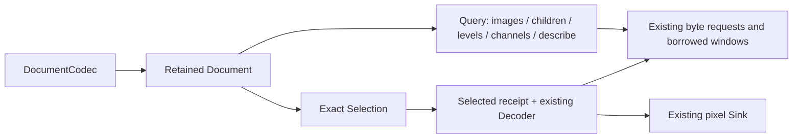

# Retained documents in the reimagined contract

The cleanest direction is a small sans-I/O mechanism plus a retained document
owner. Keep publication policy, storage admission and rendering outside that
mechanism, with explicit checked wrappers. A smaller surface must preserve their
obligations before it can replace the existing API.

This candidate completes a bounded experiment: one document/selection contract,
lazy browsing, repeated spatial selection, and a native TIFF witness. It changes
no released codec API and does not migrate every codec or publish a crate.

## Compared surfaces

| Need | Main / review designs | Captured reimagining | This candidate |
|---|---|---|---|
| Pixel work | Config/job/decoder and erased counterparts; incremental protocol | Object-safe `DecodeCodec → Decoder::step` | Reuses that decoder and `Sink` |
| Browse repeatedly | `CollectionFactory → Collection`, scoped `ImageId`, `images/children/next/describe/decode` | No retained document protocol | `DocumentCodec → Document`, paged `Query` and `Answer` |
| Seek bytes | Positioned source / range requests and drivers | Absolute `InputRequest` and borrowed `Input` | The same planner drives queries and selected decoders |
| Choose native resolution | Native adapters and retained image interpretation | No explicit native-level selection | Scoped `LevelId`, actual bounds, optional exact registration |
| Stored ROI | Exact `ImageRequest` / `RegionRequest` | No first-class selected extent | Exact signed `Bounds`, immutable `Selected` receipt |
| Select channels | Native/auxiliary interpretation in output owners | Raster/planar carriers, no browseable channel identity | Separate channel listing and exact identity/order requirement |
| Policy/storage/rendering | Checked collections, policy/control/storage and output owners | Much of this is absent | Still absent; no claim of replacement parity |

The main comparison is pinned to
[119f3133](https://github.com/imazen/zencodec/tree/119f31336e3d9a32aa7d78290cfc17035b78f050).
Its [Collection](https://github.com/imazen/zencodec/blob/119f31336e3d9a32aa7d78290cfc17035b78f050/src/collection.rs)
and [factory/opening](https://github.com/imazen/zencodec/blob/119f31336e3d9a32aa7d78290cfc17035b78f050/src/collection/factory.rs)
already establish retained identity and exact selection. This experiment carries
those semantics into the smaller byte dialogue rather than claiming them as new.
[PR208](https://github.com/imazen/zencodec/pull/208), inspected at `f4ef1c34`,
and [PR209](https://github.com/imazen/zencodec/pull/209), inspected at `fffac137`,
remain distinct review alternatives. PR209 consolidates execution internally;
it does not replace the public surface with this experiment. The starting
reimagined working-tree capture is identified in
[source-capture.json](source-capture.json), not assumed to be a main revision.

## One document, one source revision

`DocumentReader<S>` owns the source and retained document together. Its caller
can inspect source statistics but cannot swap sources underneath issued IDs.
An `Origin` scopes images, levels, channels and continuations; foreign IDs and
continuations for another listing refuse before native work. IDs survive owner
drop without becoming equal to a later document's IDs. They are not serializable
archive keys or proof that remote bytes remain unchanged.

The transport must enforce revision consistency on each read: an immutable
resident slice, a stable file snapshot, or conditional/versioned remote reads.
Holding one `ReadAt` object alone cannot establish that promise. No HTTP source
or changed-object witness is implemented here.

`Query::List` returns at most the requested nonzero page limit. A continuation
belongs to one document and listing. Queries retain parser/index state and use
`InputRequest` without constructing a pixel decoder. The page limit bounds
returned entries, not native parse work, retained index memory or the number of
queries a caller may make. The existing checked collection's cumulative discovery
allowance needs a deliberate counterpart before migration.

## Coordinates and selection

Containment, levels and channels are separate relationships. An arbitrary
SubIFD or auxiliary image must not automatically become a resolution level.
A level has a scoped identity, actual stored bounds, and optional rational scale
and offset registration to its image. Unknown registration remains unknown.
Independent horizontal/vertical scales can describe ripmap geometry without
inventing a single reduction exponent. No resampling or display-level chooser
is implemented.

Bounds have signed origins. ROI coordinates belong to the selected native level;
output rows start at zero, while `Selected` retains the original region and full
bounds. Requests never silently clip or substitute a full image. Full selected
image dimension/pixel gates apply before preparing its pixel decoder; a tiny ROI
does not excuse an oversized source image.

Channel selection preserves native identities and order or refuses. Names alone
are not identities or permission to turn scientific samples into display RGB.
The fixtures qualify all RGB channels and refusal of unsupported subsets. Native
arbitrary EXR channels, subsampling, deep samples, separate auxiliary outputs,
alpha/context parity and channel-to-plane interpretation remain unqualified.

## Admission and failure

Opened-document hard limits are intersected with per-selection limits. Both
cancellation conditions survive selection. Unknown workspace refuses a configured
native memory cap before factory construction; this prototype has no qualified
positive operation-wide memory bound. The input-window cap is retained driver
payload, not process memory, native scratch or output storage.

A selected decoder's receipt must match the requested target, channels, region,
description and registration. Its `Info` precedes every sink effect. Required
output formats, planar acceptance, metadata settlement and source/output geometry
are checked before adoption. Sink publication retains its raster, validates
strips, requires complete final-row coverage and rejects missing finish. A backend
cannot report successful completion after swallowing a destination error.
Already published pixels cannot be rolled back.

Invalid/unsupported requests rejected before execution preserve the document.
Execution errors and cancellation drop the native owner and make the session
terminal. Original transport/sink errors remain inspectable. These guards are
qualified by the listed controls, not a claim that all native code or malformed
file paths are qualified. Borrowed loan coverage establishes protocol delivery;
it cannot prove a decoder actually wrote correct samples.

## Native pull parsers

A synchronous `Read + Seek` parser cannot suspend its call stack merely because
its wrapper exposes `step`. The TIFF validation adapter runs such calls on a
worker. The worker sends positional requests; the ordinary range driver fetches
bytes; `step` returns `Continue` while computation is in flight. No second TIFF
parser was written.

This bridge copies read replies, starts workers for native operations, and joins
them on teardown. A blocked source transport or active native computation can
delay cancellation/drop. The blocking driver yields while polling `Continue`;
this is not an async wakeup implementation or a throughput result. Cooperative
resumable native parsers would avoid that bridge. A production authoring helper
needs separate work before adopting it as infrastructure.

## Format coverage ledger

| Format / concern | Implemented witness | Remaining work |
|---|---|---|
| TIFF directories and reduced SubIFDs | Native image-tiff parser; two roots, child listing, one reduced level, no sample reads during discovery | BigTIFF, arbitrary directory graphs/cycles, masks, other layouts and compression |
| TIFF ROI | Two repeated Gray8 regions fetch only the corresponding sample tile; reduced-level ROI returns exact samples | Cross-tile/edge/planar cases, old JPEG/shared tables, metadata fidelity, bounded workspace and production caching |
| EXR | Synthetic signed origins and unequal horizontal/vertical level shapes | Native multipart/channel/level adapter, data/display-window distinction, sampling and deep-data refusal/representation |
| JXL | Existing byte protocol can express replay/ranges; no native adapter here | Separate composited presentations/raw layers, reference dependencies, blend/placement, extra channels, achievable ROI and native work evidence |
| IMIJ / collections | Contract can name an archive image and native level, then select a region | Native archive adapter, source-version binding, entry-to-container range translation, dictionaries/dependency retention and region execution |
| Async / remote | Contract remains sans-I/O and core builds without default features | Async document driver, wakeups, HTTP conditional ranges and remote cancellation controls |

The EXR/JXL entries are proposals, not statements that present adapters implement
these requests. Source inspection found the current
[zenexr wrapper](https://github.com/imazen/zenextras/blob/2ebeca7d97fb12059ea1a1b10a0f1f0da7e673b5/zenexr/src/lib.rs)
decodes the largest resolution of a flat RGB/RGBA part. The current
[JXL collection adapter](https://github.com/imazen/zenjxl/blob/a3a93aaf068c589675aa5c63090ac9d07f24d07c/src/collection/mod.rs)
requires resident input, distinguishes presentations/raw layers, refuses regions,
and replays raw-layer dependencies. Those are concrete integration costs; naming
a `Selection` does not remove them.

## Recommendation and stopping point

The [readable API comparison](resident-input.html) also separates caller
conveniences, capability discovery and correctness obligations. Main's typed
one-shots, codec registry and direct output access have no complete replacement
in this candidate. The existing one-call drivers hide stepping; restoring
ordinary methods need not expose the protocol or require another trait family.
Provided defaults or caller-layer extension methods can delegate to shared
checked execution, with native optimizations held to the same contract.

Source review at `e6687695` establishes two I/O limits: the document loops create
a fresh `Window` for each query/decode, so persistent compressed-byte caching
depends on the retained source adapter; they also do not use the resident
`ReadAt::as_slice` shortcut implemented by the ordinary image drivers. Neither
document zero-copy behavior nor production cache efficiency is qualified.

Color/metadata carriers are present, but the existing retention, color-emission
and orientation-reconciliation machinery is not integrated here. The selected
document driver checks `metadata_first` against `ImageInfo::settled` before
publication. `WholeDecoder::header` in `simple.rs` has no matching settlement
check. This is a source-review finding, not a newly executed failing regression;
repair and runtime qualification remain required. Capability discovery and the
existing testkit's support/refusal and metadata-delivery disciplines likewise
need counterparts before migration.

Keep this subfork as the mechanism experiment. Preserve main/PR208's checked
admission, interpretation, metadata, source identity and storage contracts as
explicit requirements for any replacement. Use PR209's execution consolidation
where the existing surface must remain stable. Do not migrate codecs just to
make a trait-count comparison smaller.

The current gate is complete when the workspace, no-default core, strict lint,
Rustdoc/consumer example and native TIFF controls pass, with receipts preserved.
Cross-codec migration, production async adapters, performance claims and release
qualification are outside this gate.
